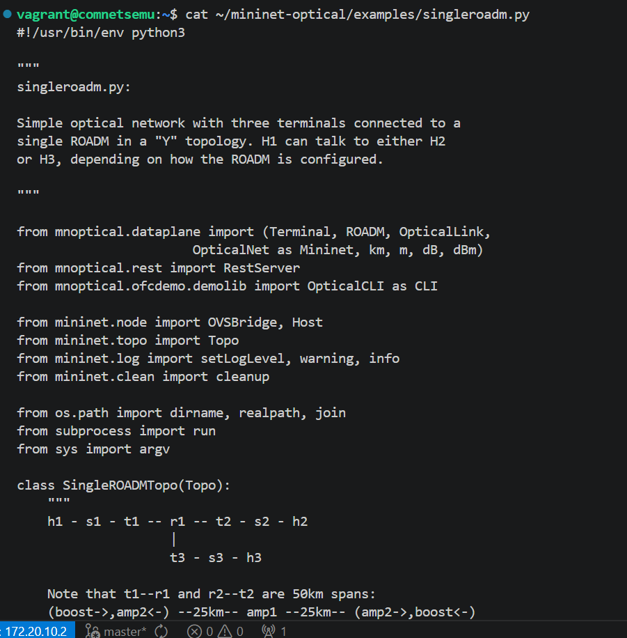

# SDN/NFV — Réseau optique ROADM (Mininet-Optical)

Mise en place d un nœud ROADM dans un réseau optique défini par logiciel.

## Contexte
TP4 SDN & NFV, Master 2 SRT (ESP/UCAD). Encadrant : Mr Sadio.

## Contenu
- `src/` : `singleroadm.py` et scripts de configuration
- `docs/` : rapport

## Licence
MIT (code) — voir `LICENSE`.

## Captures
Voir le dossier `captures/`.

